# Kosmo-Platform | Мобильная платформа КОСМО

Открытый проект учебной четырёхколёсной мобильной платформы, разработанный для участников чемпионата **[«Кубок роверов»](https://roverchallenge.ru/)**. Детали спроектированы для печати на 3D-принтере. Также доступна STEP-модель — её можно использовать для изучения конструкции и собственных доработок.

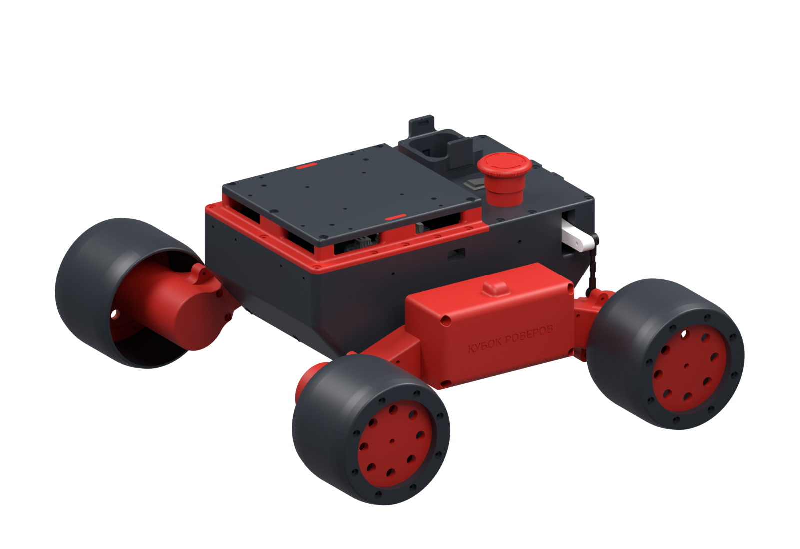

## Содержимое репозитория

| Папка | Содержимое |
| --- | --- |
| [stl](stl/) | Модели деталей для 3D-печати |
| [step](step/) | [Сборка в формате STEP](step/kosmo-platform.stp) для просмотра и редактирования в CAD |
| [media](media/) | Рендер платформы и превью STL |
| [manual](manual/README.md) | Инструкция и иллюстрации по сборке |

## Как скачать и распечатать STL

1. На странице репозитория нажмите **Code → Download ZIP**.
2. Распакуйте архив и откройте папку `stl`.
3. Импортируйте нужные файлы `.stl` в слайсер. Размеры моделей рассчитаны в **мм**; STL не хранит единицы измерения, поэтому проверьте масштаб при импорте.
4. Сначала распечатайте один `motor-mount` и проверьте посадку реального мотор-редуктора и крепежа.
5. Подберите ориентацию, поддержки и компенсацию усадки под свой материал и принтер. После проверки посадок печатайте остальной комплект.

Чтобы скачать отдельную модель, откройте её файл в папке [stl](stl/) на GitHub и нажмите **Download raw file**.

### Файлы для печати

Нажмите на превью, чтобы открыть изображение крупнее. Детали показаны в индивидуальном масштабе; ракурс превью не является рекомендацией по ориентации при печати. Количество указано для четырёхколёсной платформы.

| Превью | Файл | Описание | Количество |
| --- | --- | --- | ---: |
| [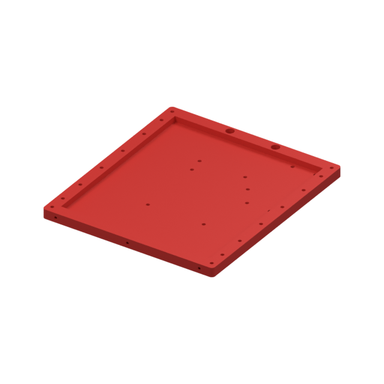](media/stl-previews/body-bottom.png) | [body-bottom.stl](stl/body-bottom.stl) | Дно центрального корпуса | 1 |
| [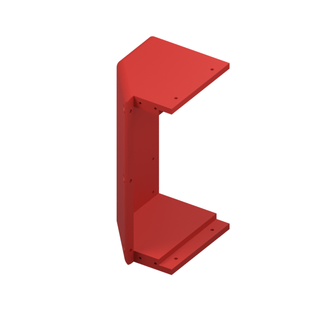](media/stl-previews/body-front.png) | [body-front.stl](stl/body-front.stl) | Передняя стенка корпуса | 1 |
| [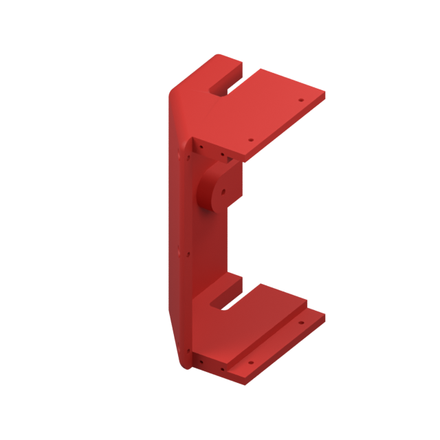](media/stl-previews/body-back.png) | [body-back.stl](stl/body-back.stl) | Задняя стенка корпуса | 1 |
| [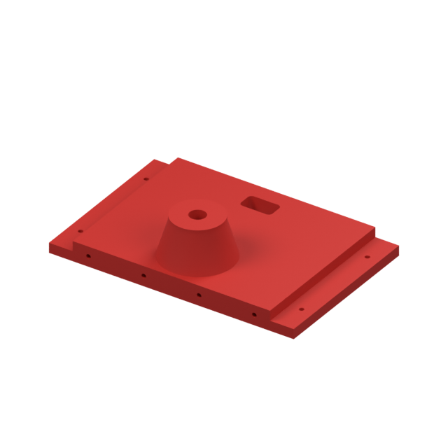](media/stl-previews/body-side.png) | [body-side.stl](stl/body-side.stl) | Боковая стенка корпуса | 2 |
| [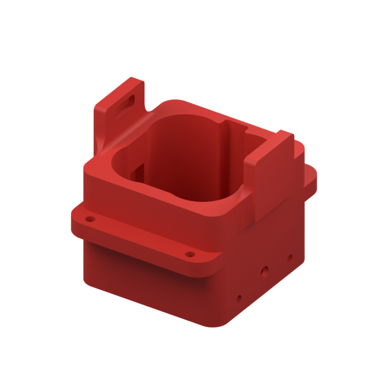](media/stl-previews/battery-4s-holder.png) | [battery-4s-holder.stl](stl/battery-4s-holder.stl) | Держатель аккумулятора 4S | 1 |
| [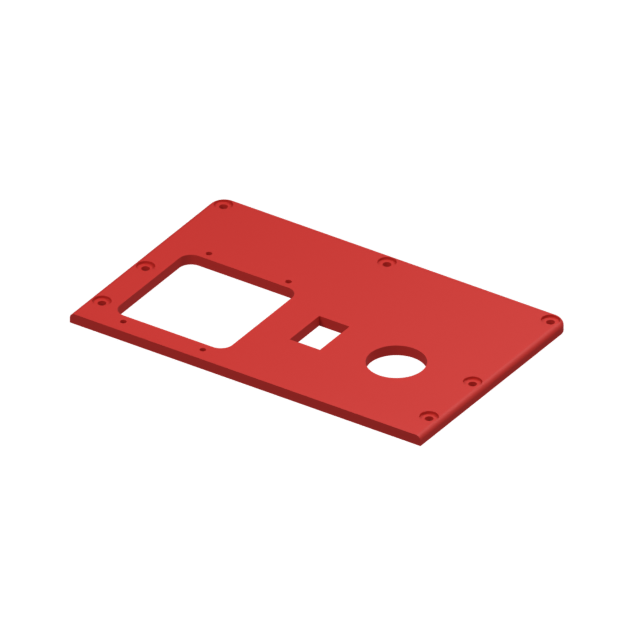](media/stl-previews/top-back.png) | [top-back.stl](stl/top-back.stl) | Задняя верхняя панель корпуса | 1 |
| [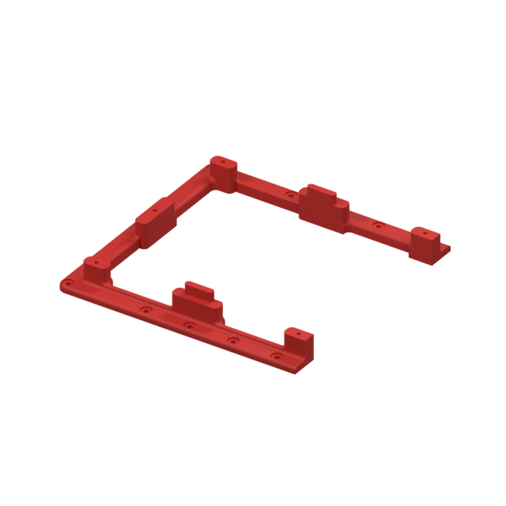](media/stl-previews/top-front-rack.png) | [top-front-rack.stl](stl/top-front-rack.stl) | Передняя верхняя рамка | 1 |
| [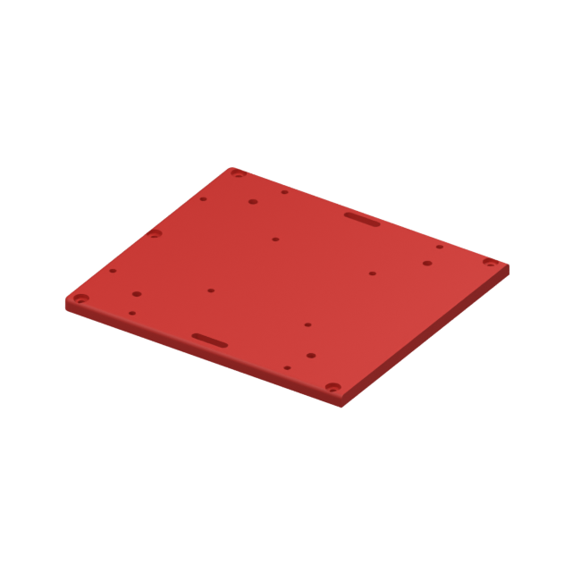](media/stl-previews/top-mount-plate.png) | [top-mount-plate.stl](stl/top-mount-plate.stl) | Верхняя монтажная площадка | 1 |
| [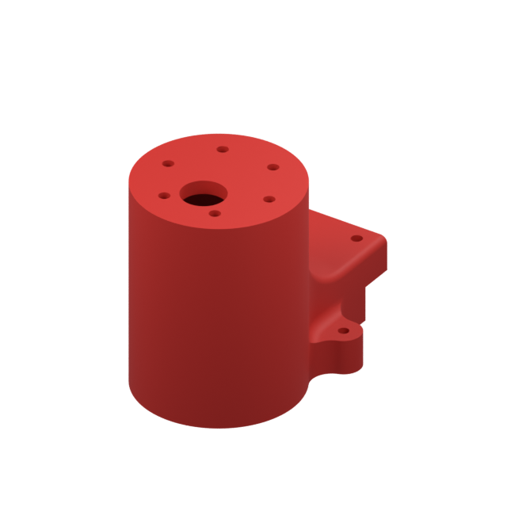](media/stl-previews/motor-mount.png) | [motor-mount.stl](stl/motor-mount.stl) | Крепление мотор-редуктора | 4 |
| [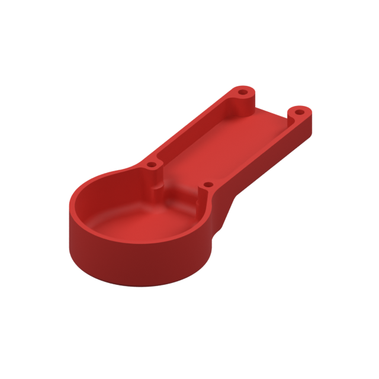](media/stl-previews/motor-cover.png) | [motor-cover.stl](stl/motor-cover.stl) | Крышка моторного узла | 4 |
| [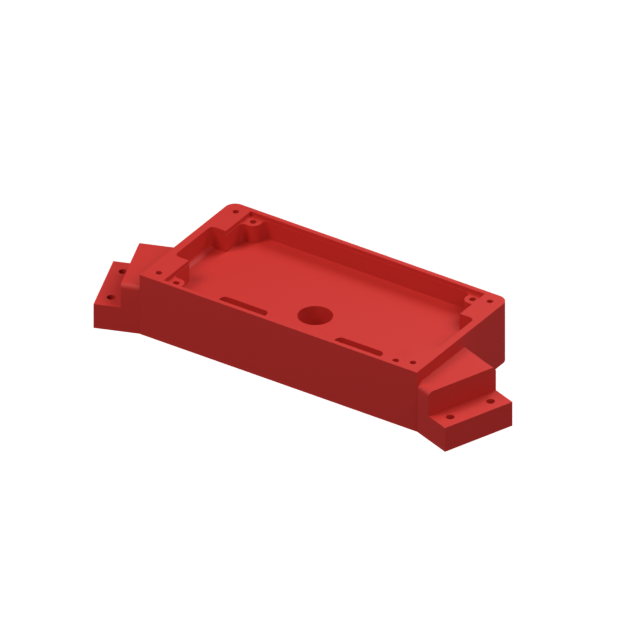](media/stl-previews/side-controll-base.png) | [side-controll-base.stl](stl/side-controll-base.stl) | Основание бокового блока | 2 |
| [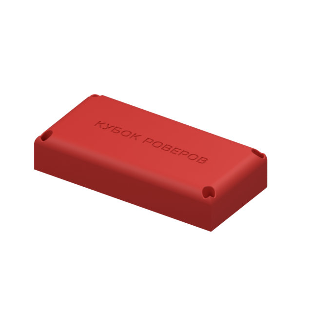](media/stl-previews/side-controll-lid-rc.png) | [side-controll-lid-rc.stl](stl/side-controll-lid-rc.stl) | Крышка бокового блока | 1 |
|  | [side-controll-lid-vb.stl](stl/side-controll-lid-vb.stl) | Крышка бокового блока | 1 |
| [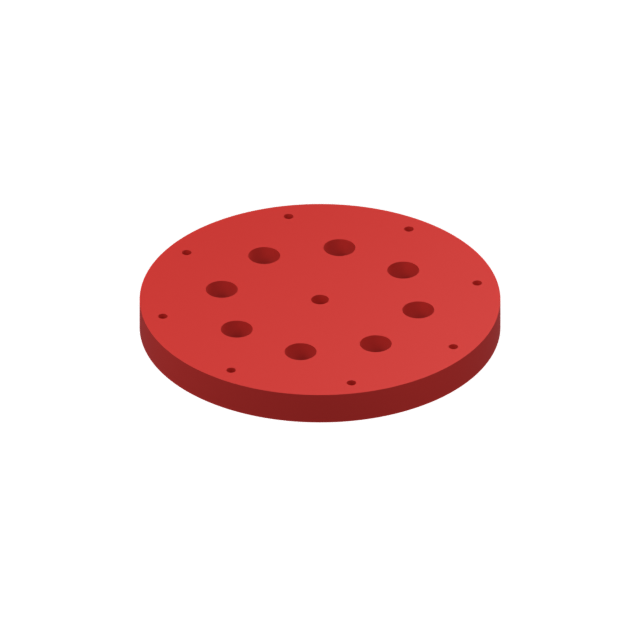](media/stl-previews/wheel-disc.png) | [wheel-disc.stl](stl/wheel-disc.stl) | Диск колеса | 4 |
| [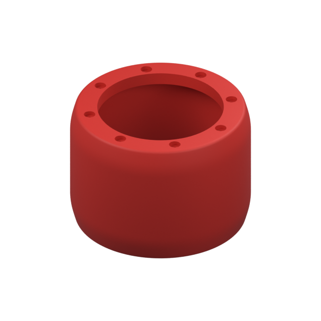](media/stl-previews/wheel-tyre.png) | [wheel-tyre.stl](stl/wheel-tyre.stl) | Шина колеса | 4 |

Для шин подберите материал с подходящей упругостью; параметры печати диска и шины могут различаться. Перед печатью всех колёс проверьте соединение одной пары деталей.

### Перед печатью полного комплекта

- Сверьте посадочные размеры с [STEP-сборкой](step/kosmo-platform.stp) и реальными двигателями, аккумулятором и платами. 
- Выберите ориентацию с учётом нагрузки на крепления двигателей и шарниры. Проверьте нависания и расположение поддержек в слайсере.
- Удалите поддержки и заусенцы, проверьте отверстия и посадки. Не затягивайте крепёж до деформации печатных деталей.
- В наборе STL отсутствуют отдельные детали рычажного механизма и часть креплений и стоек, видимых на схемах. Их расположение и геометрию смотрите в STEP.

## Сборка и первый запуск

[Общая инструкция по сборке платформы](manual/README.md) — колёсные узлы, боковые блоки, корпус, рычажный механизм, электроника и верхняя площадка.

Понадобятся четыре мотор-редуктора, крепления колёс на валах, крепёж и компоненты выбранной системы управления. Типоразмеры и длины крепежа сверяйте с  фактическими деталями. Иллюстрации показывают механическое размещение электроники; электрическая схема и прошивка в этот репозиторий не входят.

