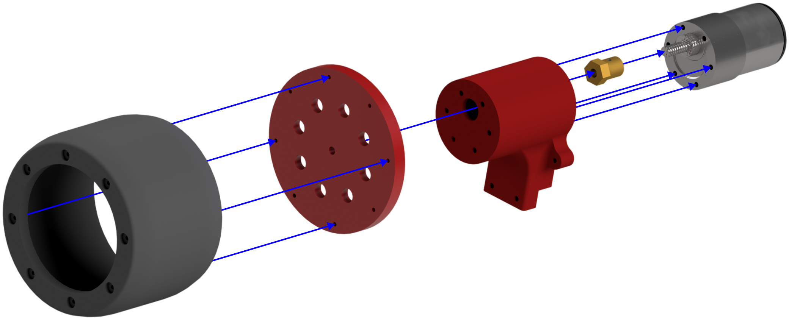
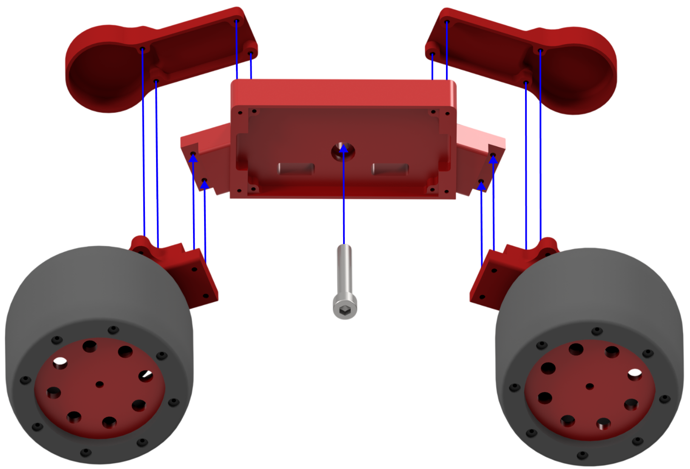
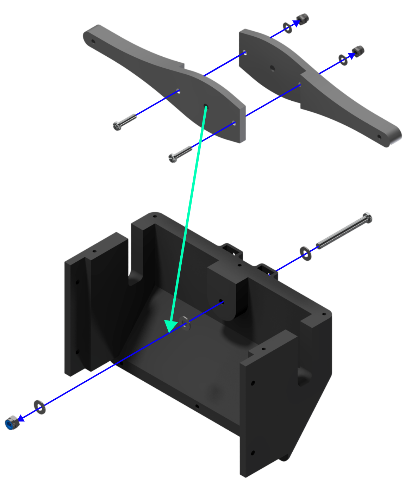
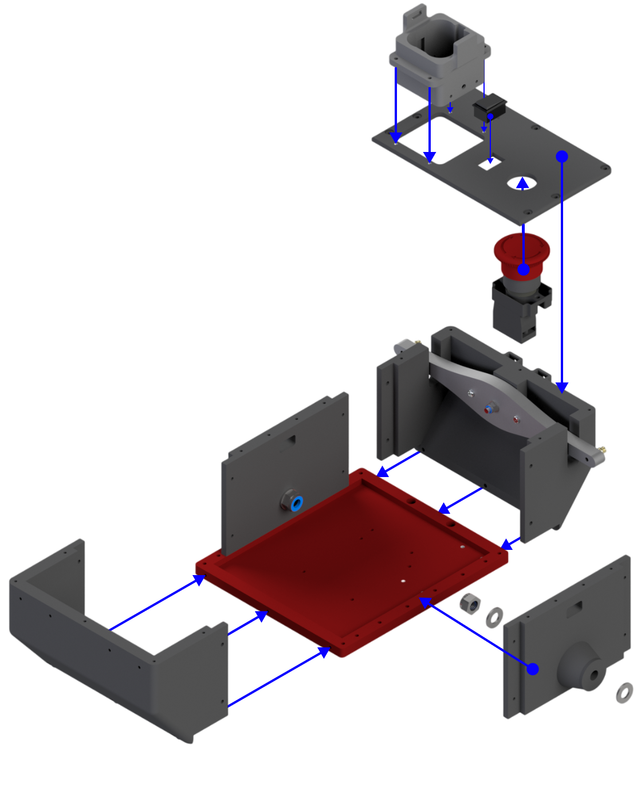
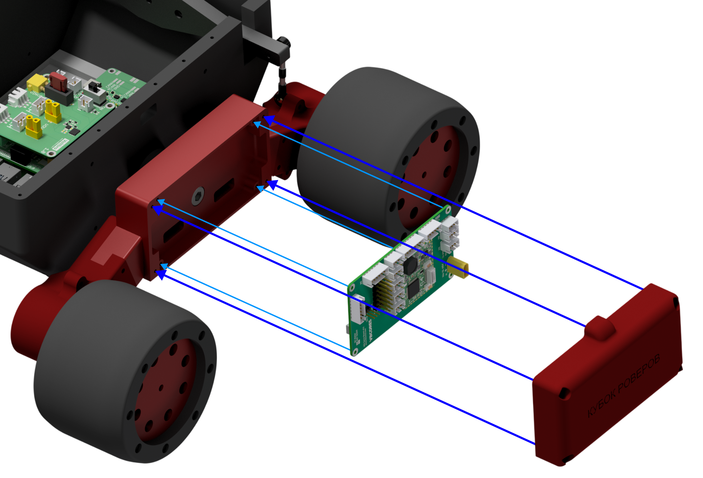
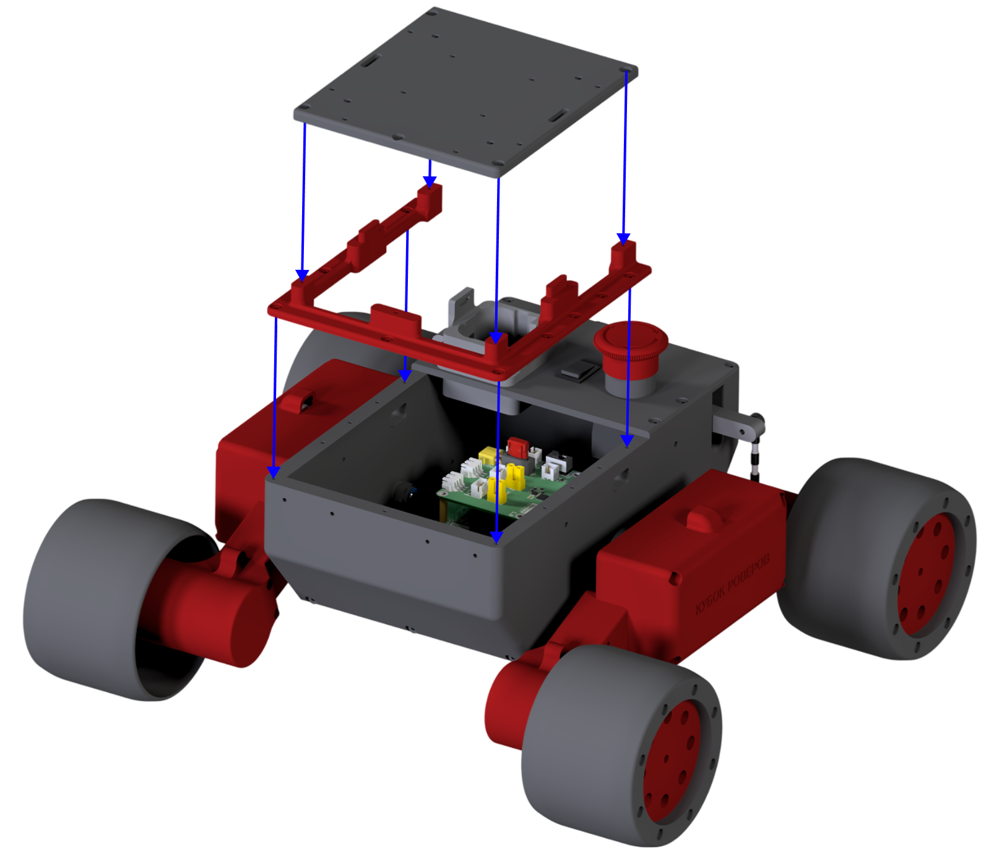

# Сборка мобильной платформы КОСМО

Используйте [STEP-сборку](../step/kosmo-platform.stp) вместе с иллюстрациями для уточнения положения деталей, крепежа и проводов. Синие стрелки показывают направление установки деталей. Набор STL содержит основные детали корпуса и приводных блоков; отдельные рычаги и крепления оборудования доступны в составе STEP.

## 1. Колёсные узлы

Соберите четыре одинаковых узла. Установите мотор-редуктор в `motor-mount`, закрепите соединение диска колеса с валом и соедините `wheel-disc` с `wheel-tyre`. Положение ступицы и винтов смотрите на схеме. До установки на платформу проверьте, что колесо вращается без контакта с корпусом двигателя и крепежом.

## 2. Боковые блоки

На каждом основании `side-controll-base` закрепите по два моторных узла. Установите крышки `motor-cover`. Соберите левый и правый блоки, сверяя ориентацию с полной STEP-сборкой. Центральное отверстие основания используется для соединения с боковой стенкой корпуса.

## 3. Корпус и рычажный механизм

Соберите рычажный узел на задней стенке по отдельной схеме. Подвижное соединение должно сохранять свободный ход после затяжки крепежа.

Соедините `body-bottom` с передней и задней стенками, затем установите две `body-side`. Установите заднюю верхнюю панель и предусмотренные выбранной комплектацией держатели, выключатель и кнопку. Точные размеры крепежа и элементы, не представленные отдельными STL, уточняйте в STEP.

Присоедините боковые блоки к корпусу и соедините рычажный механизм с ними, как показано в STEP и на следующей иллюстрации. Проверьте свободный ход боковых блоков и отсутствие контакта шин с корпусом.

## 4. Электроника бокового блока

Установите плату на предусмотренные крепления, проложите провода и закройте блок крышкой `side-controll-lid-rc` или `side-controll-lid-vb`. Выбор крышки зависит от исполнения. На схеме показано механическое размещение платы, а не схема подключения.

Провода должны иметь запас длины для движения подвески и не попадать в колёса и шарниры. Проверьте это во всём механическом диапазоне до закрытия крышек.

## 5. Верхняя рамка и монтажная площадка

Закрепите аккумулятор в держателе и установите электронику центрального корпуса. Затем закрепите `top-front-rack` и `top-mount-plate`. Перед закрытием убедитесь, что провода не зажаты, а разъёмы и выключатель остаются доступны.

## Проверка перед первым движением

1. При отключённом питании проверьте крепёж, посадку колёс и свободный ход механизма. Все четыре колеса должны опираться на ровную поверхность.
2. Подключите двигатели, питание и управление по документации выбранных плат; сверяйте полярность и допустимое напряжение с их маркировкой и документацией.
3. Первый тест проведите с вывешенными колёсами на малой скорости. Проверьте каждое колесо отдельно, затем команды движения вперёд, назад и поворота.
4. Убедитесь, что предусмотренный способ остановки отключает движение. После этого проведите короткий тест на свободной ровной площадке и повторно проверьте крепёж.

[← Вернуться к описанию проекта](../README.md)
